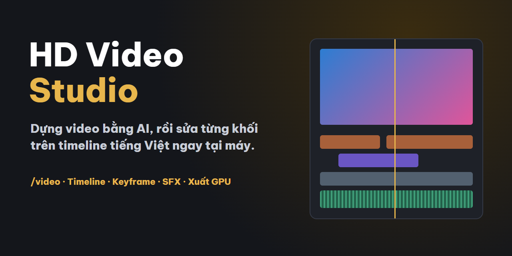
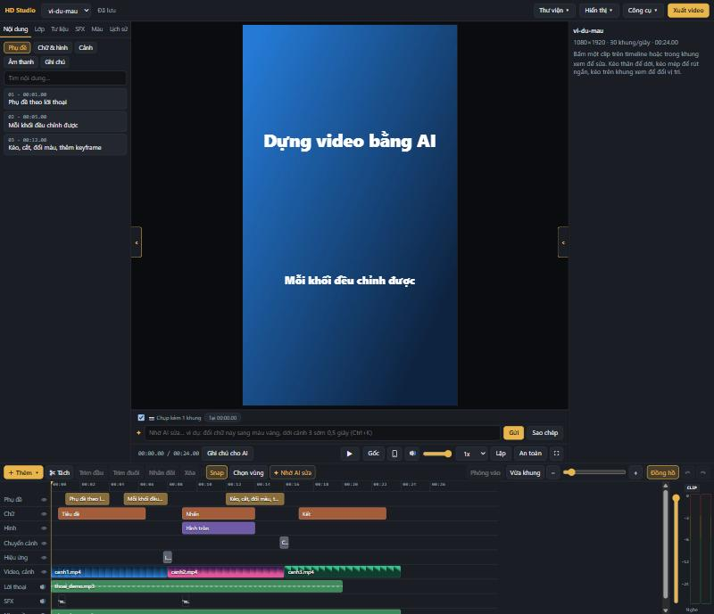

<p align="center"></p>

<h1 align="center">HD Video Studio</h1>
<p align="center">Dựng video bằng AI, rồi sửa từng khối trên timeline tiếng Việt ngay tại máy.</p>

Bạn đưa footage cho Claude Code bằng lệnh `/video`. AI chép lời, cắt dựng, chỉnh màu, thêm chữ, motion graphics, SFX và nhạc. Mọi thứ hiện thành các khối trên HD Studio để bạn kéo, cắt, đổi màu, thêm keyframe, rồi xuất video.



## Có gì trong bộ này
- **Skill `/video`:** quy trình dựng hoàn chỉnh, tự phân loại thể loại hoặc áp template, có cổng kiểm tra chất lượng.
- **9 agent chuyên trách:** chép lời, cắt dựng, màu, che địa chỉ, âm thanh, chữ và MG, render, QA.
- **HD Studio:** timeline tiếng Việt chạy tại máy, không cần tài khoản riêng.
  - Khối: chữ, phụ đề, video, ảnh, hình, nhãn dán, motion graphics, hiệu ứng, chuyển cảnh, lớp màu, lời thoại, SFX, nhạc.
  - Chỉnh sửa: keyframe kiểu CapCut, bảng Lớp và Thiết kế, khung viền chữ, đồng hồ âm thanh, kéo thả tệp.
  - Khôi phục: Lịch sử chỉnh sửa, phục hồi có xác nhận.
  - Xem và xuất: xem trước TikTok, Shorts, Reels; nhiều tỉ lệ khung hình; tự dùng GPU NVIDIA nếu có.
- **Thư viện:** 703 prompt motion graphics, 7 template phong cách, bộ dựng review bất động sản, bộ học từ video mẫu (`/watch`).


## Yêu cầu
Windows 10 hoặc 11, [Node.js](https://nodejs.org) 20.11 trở lên, [FFmpeg](https://ffmpeg.org/download.html), [Git](https://git-scm.com), Python 3, [Claude Code](https://claude.com/claude-code). Chưa hỗ trợ macOS và Linux.

## Cài đặt
```powershell
iex (irm https://raw.githubusercontent.com/hoangdung68789/hd-video-studio/main/install.ps1).TrimStart([char]0xFEFF)
```
Cài kèm tất cả repo tích hợp (HyperFrames, Remotion, WhisperX, cả skill và mã nguồn):
```powershell
& ([scriptblock]::Create((irm https://raw.githubusercontent.com/hoangdung68789/hd-video-studio/main/install.ps1).TrimStart([char]0xFEFF))) -TatCa
```
Chỉ cài kèm vài thành phần: thay `-TatCa` bằng `-ThanhPhan remotion,hyperframes-skills`.

### Cài từng thành phần
Đã cài bộ này rồi thì chạy trong thư mục cài. Không có tham số sẽ hiện menu để chọn:
```powershell
powershell -ExecutionPolicy Bypass -File .\cai-thanh-phan.ps1
```
Thêm vào cuối lệnh trên: `-ThanhPhan remotion` để cài thẳng một phần, `-TatCa` để cài tất cả, `-DanhSach` để xem danh sách.

| Thành phần | Nội dung | Repo gốc |
|---|---|---|
| `hyperframes` | Lệnh HyperFrames, HD Studio cần để xem trước và xuất (bộ cài chính đã tự cài) | [heygen-com/hyperframes](https://github.com/heygen-com/hyperframes) |
| `hyperframes-skills` | Skill HyperFrames cho Claude Code | [heygen-com/hyperframes](https://github.com/heygen-com/hyperframes) |
| `hyperframes-nguon` | Mã nguồn vào `vendor\hyperframes` | [heygen-com/hyperframes](https://github.com/heygen-com/hyperframes) |
| `remotion` | Dự án mẫu tại `remotion-mau` | [remotion-dev/remotion](https://github.com/remotion-dev/remotion) |
| `remotion-skills` | Skill Remotion cho Claude Code | [remotion-dev/skills](https://github.com/remotion-dev/skills) |
| `remotion-nguon` | Mã nguồn vào `vendor\remotion` | [remotion-dev/remotion](https://github.com/remotion-dev/remotion) |
| `whisperx` | Chép lời từng từ, tải thêm vài GB gồm PyTorch, cần Python 3.10–3.13 | [m-bain/whisperX](https://github.com/m-bain/whisperX) |

Remotion có giấy phép riêng: công ty trên 3 người cần mua giấy phép, xem [remotion.dev/license](https://www.remotion.dev/license).

Mặc định cài vào `%USERPROFILE%\HDRE AI`. Skill và agent đang có cùng tên được sao lưu trong `.claude` trước khi thay.

## Bắt đầu
**Xem Studio ngay:** chạy `Apps\hd-studio\Mo Studio.bat`, chọn dự án `vi-du-mau`.

**Dựng video:** mở Claude Code trong thư mục đã cài, rồi gõ:
```
/video D:\footage\nha-mau.mp4 bds
```
Khi AI dựng xong, mở dự án trong Studio để sửa. Bấm **Xuất video** để lấy bản cuối.

## Tài nguyên riêng
Repo không kèm SFX, font, LUT và danh mục CapCut. Studio vẫn chạy khi thiếu, chỉ trống phần tương ứng. Có hai cách thêm:
1. Đặt vào thư mục `TaiNguyen` cạnh `Apps`: `SFX`, `Fonts`, `Template_Video`, `CapCut Text Preset.zip`, `freshluts-LUT-phan-loai.zip`.
2. Vào **Công cụ → Thư mục tài nguyên** trong Studio để chỉ đường dẫn.

Nếu bạn có gói tài nguyên dạng .zip: `powershell -ExecutionPolicy Bypass -File .\install.ps1 -TaiNguyen "D:\tai-nguyen"`.

Nếu bạn được cấp mật khẩu tải tài nguyên, chạy lệnh sau trong thư mục đã cài (cần Python 3) rồi nhập mật khẩu:
```powershell
powershell -ExecutionPolicy Bypass -File .\tai-tai-nguyen.ps1
```
Chỉ tải một vài gói: thêm `-Goi SFX,Font` (các gói: `SFX`, `Font`, `FontCapCutGoc`, `LUT`, `Mau`). Toàn bộ khoảng 7,8 GB. Tệp đã tải không tải lại. Repo không chứa tài nguyên. Dùng thư mục Drive của riêng bạn: thêm `-Link "<link>"`, khi đó không cần mật khẩu.

## Nối Studio với phiên Claude
Đang mở Studio, nhắn bất kỳ gì trong một phiên Claude Code mở ở thư mục cài thì phiên đó tự nối (nhờ hook trong `.claude/settings.json`). Mỗi phiên có hộp thư riêng. Khung AI tự gửi vào phiên vừa dùng gần nhất, hoặc chọn phiên khác trong danh sách cạnh ô nhập. Không có phiên nào nối thì dự án dùng phiên riêng.

## Cấu trúc
| Thư mục | Nội dung |
|---|---|
| `skills/` | Skill `/video` và các skill đi kèm |
| `agents/` | Agent `dung-*` |
| `Apps/hd-studio/` | HD Studio |
| `asset/` | Thư viện MG, phong cách, quy tắc |
| `Videos/` | Dự án mẫu và bộ dựng review BĐS |
| `vendor/claude-video/` | Mã nguồn đầy đủ của `/watch` |
| `vendor/motion-design-skill/` | Mã nguồn đầy đủ của skill `motion-design` |
| `vendor/whisperX/` | Mã nguồn đầy đủ của WhisperX: chép lời có mốc thời gian từng từ |
| `vendor/hyperframes/`, `vendor/remotion/` | Submodule trỏ tới repo gốc, chỉ tải khi cần |

## Xử lý lỗi thường gặp
| Hiện tượng | Cách xử lý |
|---|---|
| Không có SFX, font | Xem mục Tài nguyên riêng |
| Thanh AI báo không tìm thấy Claude | Cài Claude Code, hoặc đặt biến `HD_CLAUDE_BIN` |
| Xuất chậm | Máy không có card NVIDIA nên dùng CPU, đây là bình thường |

## Ghi công
- [HyperFrames](https://github.com/heygen-com/hyperframes) (Apache-2.0, HeyGen): máy xem trước và render.
- [Remotion](https://github.com/remotion-dev/remotion) (giấy phép riêng của Remotion): dựng video bằng React.
- [awesome-opus5-5-videos](https://github.com/yihui-dev/awesome-opus5-5-videos) (MIT, yihui-dev): thư viện prompt MG.
- [claude-video](https://github.com/hoangdung68789/claude-video) (MIT, Bradley Bonanno): `/watch`.
- [motion-design-skill](https://github.com/hoangdung68789/motion-design-skill) (MIT, LottieFiles): nguyên lý chuyển động.
- [whisperX](https://github.com/hoangdung68789/whisperX) (BSD-2-Clause, Max Bain): chép lời có mốc thời gian từng từ.
- [GSAP](https://gsap.com): hoạt ảnh.

Các skill ngoài cần cài thêm: xem `DEPENDENCIES.md`.

## Liên hệ
Hoàng Dũng · Hoàng Dũng Real Estate
Facebook: [Khối Hoàng Anh - Thiên Khôi](https://www.facebook.com/iamhoangdung)
